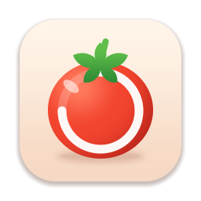
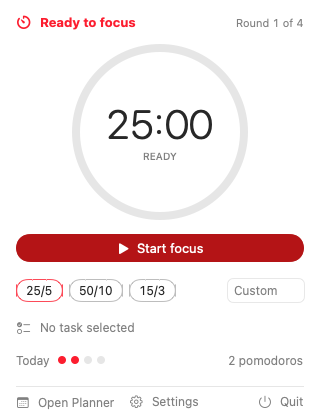
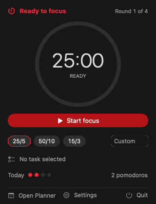
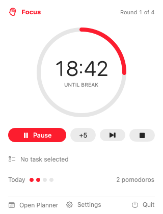
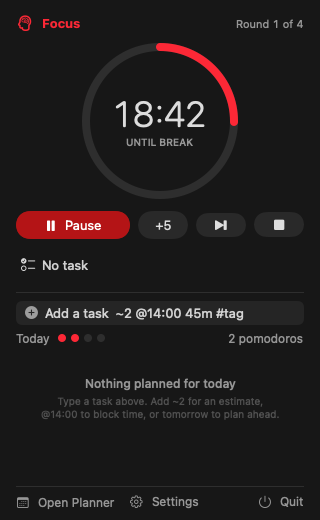
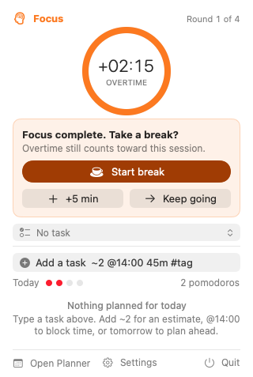
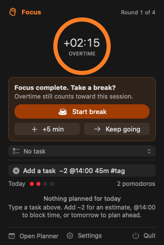

# Pomodoro

A native macOS menu-bar Pomodoro timer that lets you keep going when you're in flow, with tasks
and time-blocking built in.

## Features

- **Menu bar timer.** Shows `🍅 18:42`, `☕ 03:10`, or `+02:15` overtime. Display modes: icon
  only, time, or time plus the current task. No Dock icon, no windows in the way.
- **Flow-mode overtime.** When focus ends you get a chime and a prompt (*Start break*, *+5 min*,
  *Keep going*). Keep going and the menu bar counts up the overtime, which is logged against your
  task, with a gentle re-nudge every few minutes.
- **Presets and one-offs.** Classic 25/5/15, plus named presets like *Deep 50/10*. Pick a chip or
  type `40` or `50/10` to change just the next session.
- **Tasks with quick-add.** Type `Write spec ~3 @14:00 45m #work` and get a task with an estimate,
  a tag, and a time block. See the [grammar](#quick-add-grammar) below.
- **Time-blocking planner.** A day timeline from 06:00 to 24:00 to drag tasks onto. Inside a
  block, the popover suggests that block's task.
- **Sounds.** Original, procedurally generated chimes for focus end, break end, and start, plus an
  optional soft tick, with master volume.
- **Notifications** with actions, so you can start a break or keep going without opening anything.
  Sleep and lid close are reconciled on wake.
- **Wall-clock accurate.** The timer is anchored to the clock rather than counting ticks, so it
  stays correct across sleep and uses almost no CPU while idle.

- **Global hotkeys** for start/pause, skip, show the timer, and quick-add, plus launch at login.

> Status: the planner's day timeline (#11) and stats (#13) are in progress.

## Screenshots

| | Light | Dark |
|---|---|---|
| Idle |  |  |
| Focus |  |  |
| Overtime |  |  |

Screenshots are the snapshot-test references, so they always match the current UI.

## Install

1. Download `Pomodoro-X.Y.Z.zip` from [Releases](https://github.com/krishnavalliappan/pomodoro/releases)
   and, optionally, check it against the `.sha256` file: `shasum -a 256 -c Pomodoro-X.Y.Z.zip.sha256`.
2. Unzip it.
3. The app is ad-hoc signed, not notarized, so clear the quarantine flag Gatekeeper sets on
   downloads:

   ```sh
   xattr -dr com.apple.quarantine Pomodoro.app
   ```

4. Move `Pomodoro.app` to `/Applications` and open it. Look for the tomato in the menu bar.

Requires macOS 14 Sonoma or later.

## Build from source

You need macOS 14+, Xcode 26, and [XcodeGen](https://github.com/yonaskolb/XcodeGen).

```sh
git clone https://github.com/krishnavalliappan/pomodoro.git && cd pomodoro
brew install xcodegen
xcodegen generate
xcodebuild -project Pomodoro.xcodeproj -scheme Pomodoro -configuration Release \
  -destination 'platform=macOS' -derivedDataPath build build
open build/Build/Products/Release/Pomodoro.app
```

Or run `xcodegen && open Pomodoro.xcodeproj` and press ⌘R.

## Keyboard shortcuts

In the popover:

| Shortcut | Action |
|---|---|
| Space | Start, pause, or resume |
| ⌘. | Stop and log the session |
| ⌘, | Settings |
| ⌘Q | Quit |

Global hotkeys have no defaults, so they can't clash with other apps. Set them in
**Settings → Shortcuts**:

| Hotkey | Action |
|---|---|
| Start or pause | Start, pause, or resume the timer from anywhere |
| Skip to next phase | End the current phase and move on |
| Show or hide timer | Toggle the popover |
| Quick-add task | Open the popover with the quick-add field focused |

## Quick-add grammar

Type a task title followed by any of these, in any order:

| Token | Meaning | Example |
|---|---|---|
| `~N` | Estimate in pomodoros (1–99) | `~3` |
| `#tag` | Tag (letters, digits, `_ - /`) | `#work` |
| `@HH:mm`, `@H`, `@2pm` | Start a time block at that time | `@14:00`, `@9`, `@2:30pm` |
| `Nm`, `Nh`, `NhMm` | Block length; only with an `@` time | `45m`, `2h`, `1h30m` |
| `today`, `tomorrow`, a weekday | Day for the block (next occurrence, today included) | `friday` |

`~`, `#`, and `@` tokens count anywhere in the line. Durations and day words count only at the end,
so `Prep Monday standup notes` keeps its title. Without a length, a block lasts the estimate
(N × 25 min) or 30 minutes. Prefix a word with `\` to keep it literal, for example `\#1 priority`.

Example: `Write spec ~3 @14:00 45m #work tomorrow` creates *Write spec*, estimated at 3 pomodoros,
tagged `work`, with a 45-minute block tomorrow at 14:00.

## Privacy

Everything stays on your Mac. Tasks, sessions, and blocks live in a local SQLite database, and
settings live in `UserDefaults`. The app makes no network requests and has no analytics or
telemetry.

## License

TBD. Until a license is added, all rights are reserved.

## Development

See [`PLAN.md`](PLAN.md) for the spec and [`AGENTS.md`](AGENTS.md) for contributor and agent rules.
Created in [T3 Code](https://t3.codes).

### Layout

```
App/                      SwiftUI app target (thin, menu-bar only, LSUIElement)
Packages/PomodoroCore/    pure-Swift logic package (no SwiftUI/AppKit) + its tests
Tests/PomodoroTests/      app test target (snapshot tests)
Snapshots/                snapshot reference PNGs
scripts/gen_sounds.py     regenerates App/Resources/Sounds/*.wav (stdlib Python, deterministic)
scripts/gen_icons.py      regenerates the app icon and menu bar glyph in Assets.xcassets (same)
project.yml               XcodeGen spec — the .xcodeproj is generated, never committed
```

### Build locally (macOS 14+, Xcode 26)

```sh
brew install xcodegen && xcodegen && open Pomodoro.xcodeproj
```

Or from the command line:

```sh
xcodegen generate
swift test --package-path Packages/PomodoroCore
xcodebuild -project Pomodoro.xcodeproj -scheme Pomodoro -destination 'platform=macOS' build test
```

Re-run `xcodegen` whenever you add or remove files or change `project.yml`.

### CI

`.github/workflows/ci.yml` runs on `macos-latest` with Xcode pinned to 26.6 for every PR and
every push to `main`: XcodeGen → `swift test` for `PomodoroCore` → `xcodebuild build test` →
a check that `LSUIElement` is set in the built `Info.plist`. Artifacts:

- `snapshots`: `reference/` holds the reference PNGs (plus any recorded on this run), and
  `failures/` holds failed renders. On a mismatch, `failures/<TestClass>/<test>/` also holds
  `reference.png`, `failure.png` (actual), and `difference.png`, exported from the xcresult.
- `xcresult`: the full test result bundle.
- `Pomodoro.app`: zipped Release build (pushes to `main` only; PRs build Release but don't upload).

### Releases

`.github/workflows/release.yml` builds Release, ad-hoc signs it (`codesign --force --deep -s -`),
verifies the signature and `Info.plist` (`LSUIElement`, version, icon), zips the app with `ditto`,
and writes a SHA-256 checksum.

- **Tag `vX.Y.Z`**: publishes a GitHub Release with `Pomodoro-X.Y.Z.zip` and its `.sha256`. The tag
  must match `MARKETING_VERSION` in `project.yml` and `Version.current` in `PomodoroCore`, so bump
  both in a PR first. `CFBundleVersion` is the workflow run number.
- **Dry run**: *Actions → Release → Run workflow* with `dry_run` checked (the default), or any PR
  touching the workflow, `scripts/`, or `project.yml`. It only uploads the zip as an artifact.

### App icon

`python3 scripts/gen_icons.py` redraws `AppIcon.appiconset` (all macOS sizes) and the
`MenuBarIcon` template glyph from signed distance fields, so every size is drawn rather than
downscaled. Commit the PNGs; `StatusItemIconTests` snapshots them.

### Snapshot tests

Snapshot tests use [swift-snapshot-testing](https://github.com/pointfreeco/swift-snapshot-testing)
and store references in `Snapshots/` as `<View>.<variant>.png` (for example `PopoverView.dark.png`).

**Strategy: commit references and record when one is missing.** If a reference doesn't exist,
the test writes it and then **fails** on purpose, so a PR can't go green without a committed
reference. To add a snapshot for a new view:

1. Push the test. CI fails with "No reference was found on disk" and uploads the newly
   recorded PNG in the `snapshots` artifact under `reference/`.
2. Download it and look at it: `gh run download <run-id> -n snapshots -D /tmp/snapshots`.
3. Copy the new PNGs into `Snapshots/`, commit, and push. CI goes green.

To re-record an intentional UI change, delete the old PNG and follow the same steps, or run the
tests locally on a Mac and commit the result. References are rendered by the CI runner (macOS 26,
Xcode 26.6). A local Mac with a different OS version may render slightly differently, so treat
CI-rendered PNGs as the source of truth.

When `macos-latest` moves to a new macOS image, or `XCODE_VERSION` changes, update both in one
PR and re-record every reference in that same PR. AppKit rendering follows the OS, so references
are only valid for the runner image and Xcode that rendered them.
